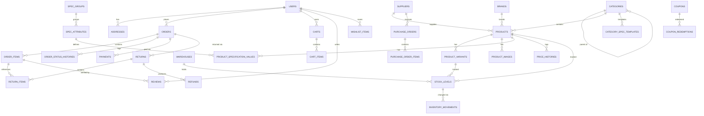

# Electronic Store — Architecture

Production-ready e-commerce platform for electronics. Modular Laravel monolith serving a Vue 3 storefront + custom admin dashboard over Inertia.js, with a versioned REST API (`/api/v1`) for a future mobile app. Web and API controllers share the same Action classes — business logic lives in exactly one place.

```text
Browser  → Laravel → Inertia.js → Vue 3 (storefront + admin)
Mobile   → REST /api/v1 (Sanctum bearer tokens) → same Actions
```

## 1. Technology Decisions

| Decision | Choice | Why |
|---|---|---|
| Framework | Laravel 12, PHP 8.5 | Latest stable on this machine (Herd) |
| Database | **PostgreSQL 17** | Spec preference; installed via Homebrew (MySQL was present but credentials unavailable; Postgres is the better choice anyway for `FOR UPDATE` row locking, partial indexes, and ILIKE search) |
| Frontend | Vue 3 + TypeScript + Composition API + Inertia 2 + Tailwind 4 | From the official `laravel/vue-starter-kit` — gives auth scaffolding, ziggy routes, dark mode, reka-ui primitives |
| Auth (web) | Session (Fortify-style controllers from starter kit) + email verification | |
| Auth (mobile) | Sanctum personal access tokens, `Authorization: Bearer` | |
| Permissions | `spatie/laravel-permission` + native Policies | Roles: super_admin, admin, inventory_manager, order_manager, customer |
| Audit log | `spatie/laravel-activitylog` (+ IP / user-agent via tap) | Mature, records before/after diffs |
| API docs | `dedoc/scramble` | OpenAPI generated from code — no annotations to rot |
| Money | Integer **cents** (`bigint`) everywhere | No float rounding bugs; formatted at the edge |
| Queues/cache | Redis (running locally) | Emails, notifications, exports |
| Testing | Pest 4 | Feature tests for every critical flow |
| Search | Postgres `ILIKE` + trigram-friendly indexes | No external engine needed at this scale; swappable for Scout later |
| Excel export | CSV streaming (chunked) | No heavy XLSX dependency; opens in Excel; can add `maatwebsite/excel` later |

**Deliberate deviations from the prompt** (documented, per instructions):
- *Money as integer cents* instead of decimals — safer arithmetic; DTOs/Resources expose formatted values.
- *Single-warehouse default with multi-warehouse schema* — stock is modeled per-warehouse from day 1; a default warehouse is seeded so checkout works without choosing one.
- *Activitylog for audit* rather than a hand-rolled table — same fields (user, action, subject, before/after, IP, UA, timestamp), battle-tested.

## 2. Modules

| Module | Responsibilities |
|---|---|
| Auth & Accounts | Register, login, logout, password reset, email verification, profile, activation, token management, admin 2FA-ready |
| Catalog | Categories (nested), brands, products, variants, images, specifications (EAV with templates), price history |
| Inventory | Warehouses, stock levels (available/reserved/damaged), movement ledger, adjustments, transfers, counts, alerts |
| Purchasing | Suppliers, purchase orders, partial receiving → movements |
| Cart & Checkout | Guest + auth carts, merging, coupons, server-side totals, stock validation |
| Orders | Snapshots, status history, cancellation, invoices, payments abstraction |
| Returns & Refunds | Request → review → approve/reject → receive → restock/damage → refund |
| Engagement | Wishlist, reviews (verified purchase + moderation), notifications |
| Reporting | Sales, inventory, profit reports; CSV export |
| Platform | Roles/permissions, audit logs, settings, REST API v1 |

## 3. Entity-Relationship Design



## 4. Database Tables (all money in integer cents)

**Catalog**: `categories` (nested, slug, active, position), `brands`, `products` (sku, barcode, slugs, descriptions, cost/regular/sale price, tax rate, low-stock threshold, warranty, weight/dimensions, status enum, featured, SEO, created_by/updated_by, soft deletes), `product_variants` (sku, barcode, prices, attributes jsonb, status), `product_images` (path, position, is_primary), `specification_groups`, `specification_attributes` (unit, type), `category_specification_templates`, `product_specification_values`, `price_histories`.

**Inventory**: `warehouses`, `stock_levels` (product/variant × warehouse: on_hand, reserved, damaged, incoming; unique composite), `inventory_movements` (immutable ledger: type enum, qty_before/change/after, reference morph, reason, user), `stock_transfers` + items, `stock_counts` + items, `suppliers`, `purchase_orders` + items (qty_ordered / qty_received).

**Commerce**: `carts` (user or session token), `cart_items`, `coupons`, `coupon_redemptions`, `orders` (number, contact + address snapshots jsonb, totals, payment_method/status, status, notes), `order_items` (product/variant refs + name/sku/price snapshots), `order_status_histories`, `payments`, `returns`, `return_items`, `refunds`, `addresses`, `wishlist_items`, `reviews`, `settings`, `activity_log` (audit), permission tables.

## 5. Route Structure

```text
Web (session):        /, /products, /products/{slug}, /category/{slug}, /brand/{slug},
                      /search, /cart, /checkout, /wishlist, /account/…, /pages/{static}
Admin (session+role): /admin, /admin/products, /admin/categories, /admin/brands,
                      /admin/specifications, /admin/warehouses, /admin/inventory,
                      /admin/suppliers, /admin/purchase-orders, /admin/orders,
                      /admin/returns, /admin/refunds, /admin/customers, /admin/reviews,
                      /admin/coupons, /admin/reports/…, /admin/users, /admin/roles,
                      /admin/audit-logs, /admin/settings
API v1 (Sanctum):     /api/v1/auth/…, /api/v1/products, /api/v1/categories, /api/v1/brands,
                      /api/v1/cart/…, /api/v1/checkout, /api/v1/orders/…, /api/v1/addresses/…,
                      /api/v1/wishlist/…, /api/v1/reviews, /api/v1/returns
```

## 6. Role & Permission Matrix

Permissions follow `verb.resource` naming. Roles get permission sets; policies check permissions (never role names), so custom Admin roles compose freely.

| Permission group | Super Admin | Admin | Inventory Mgr | Order Mgr | Customer |
|---|---|---|---|---|---|
| catalog.* (products, categories, brands, specs) | ✓ | per-grant | ✓ | — | — |
| inventory.* (stock, warehouses, transfers, counts) | ✓ | per-grant | ✓ | — | — |
| purchasing.* (suppliers, POs, receiving) | ✓ | per-grant | ✓ | — | — |
| orders.* (view, status, notes, invoices) | ✓ | per-grant | — | ✓ | — |
| returns.* / refunds.* | ✓ | per-grant | — | ✓ | — |
| customers.view / customers.manage | ✓ | per-grant | — | view | — |
| reviews.moderate, coupons.*, reports.view | ✓ | per-grant | reports | reports | — |
| users.*, roles.*, audit.view, settings.* | ✓ | — | — | — | — |
| storefront (browse, cart, order, review, return) | ✓ | ✓ | ✓ | ✓ | ✓ |

Super Admin bypasses via `Gate::before`. Admin area gated by `can:access-admin` + active account.

## 7. Lifecycles

**Inventory** — every change goes through `Inventory\RecordMovement` inside a transaction with the `stock_levels` row locked (`FOR UPDATE`). Ledger types: initial, purchase_receipt, customer_order, order_cancellation, customer_return, supplier_return, manual_increase, manual_decrease, damaged, transfer_out, transfer_in, correction. `qty_after` on the ledger must always equal the stock row — never update stock silently.

**Order** — `pending → confirmed → processing → ready_for_shipping → shipped → delivered → completed`, with `cancelled` (until shipped), `returned`, `refunded`. Transitions validated by a state map in `OrderStatus`; every transition writes `order_status_histories` and audit log. Checkout: one DB transaction → lock stock rows → validate availability → reserve (`reserved += qty`) → create order + item snapshots → movements → commit. Cancel: release reservations, restore stock, ledger entries.

**Return/Refund** — `requested → under_review → approved|rejected → item_received → refunded → closed`. On receive, each item is restocked (movement `customer_return`) or marked damaged. Refunds (full/partial, with reference) update order payment status; all transactional.

## 8. Security

CSRF (Inertia default), XSS (Vue escaping; no v-html on user content), policies on every resource (IDOR-safe: route-model binding scoped to owner), `$fillable` everywhere with DTO-mediated writes, rate limiting (API 60/min, login throttled 5/min + per-email), signed URLs for invoice downloads, uploads validated by MIME + stored with hashed names on non-executable disk, prices/totals/stock always recomputed server-side, idempotency keys on checkout, bcrypt hashing, admin routes behind role middleware + optional 2FA hook, DB transactions on all multi-write operations, audit trail on sensitive actions.

## 9. Implementation Layout

```text
app/
├── Actions/{Auth,Cart,Catalog,Checkout,Inventory,Orders,Payments,Purchasing,Returns}/
├── DTOs/           # readonly data objects for action inputs
├── Enums/          # OrderStatus, PaymentStatus, MovementType, ProductStatus, …
├── Http/Controllers/{Web,Admin,Api/V1}/
│                   # one controller = one responsibility: feature folders
│                   # (Admin/Products, Admin/Orders, Api/V1/Auth, …), thin CRUD
│                   # controllers, single-action __invoke for workflow verbs
├── Http/{Requests,Resources/V1,Middleware}/
├── Models/  ├── Policies/  ├── Notifications/
├── Services/       # Admin/* + Storefront/* query/page prop builders,
│                   # Payments gateway abstraction, Reports, Settings
└── Support/        # Money, OrderNumber, helpers
resources/js/
├── pages/{storefront,admin,auth,account}/
├── layouts/ (StoreLayout, AdminLayout, AuthLayout)
├── components/{store,admin,ui}/
├── composables/ (useCart, useLocale, useToast, …)
└── lib/ i18n (en/ar + RTL)
```
